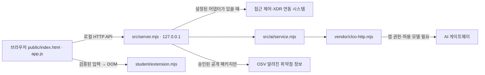

# 케셰브 학생 실행 설명서

## 목적과 범위

직원 본인의 로그인·기기·세션, 업무 앱 접근 판정, 최근 보안 기록과 저장된 XDR 경보를 표시합니다. AI 설명은 참고이며 조치 제안과 실제 효과는 구분합니다. 바이러스 치료나 전체 직원의 기록 조회 도구가 아닙니다. 조회 결과가 없다는 사실은 앱 전체가 안전하다는 보장이 아닙니다.

이 문서는 제출 코드 package.json의 alekov-client-starter 0.2.11과 일치하도록 작성했습니다. 포털에서 제공하는 새 설치판을 이미 적용한 프로젝트에는 해당 배포판의 설명서를 먼저 대조하세요. 기존 학생 파일을 덮어쓰지 않습니다.

## 준비와 폴더

필요 프로그램은 Windows PowerShell, Node.js와 Git, JavaScript를 지원하는 브라우저입니다. 제공 engines.node 기준은 24.19.0이며 이번에 확인한 실행 버전은 24.21.0, Git은 2.55.0.windows.5입니다. 다른 OS·Node 버전은 미확인입니다.

```text
프로젝트/                 ← Git 최상위, 커밋·원문 내보내기 위치
  on-client/              ← 실행 명령을 입력하는 위치
    package.json          ← start/demo/check 명령, 외부 npm 의존성 없음
    .env.example          ← 비밀 없는 설정 참고 자료
    public/index.html     ← 제공 메뉴·패널
    public/app.js         ← 제공 API 요청, 입력 검증, 취소·세대 관리
    src/server.mjs        ← 127.0.0.1 로컬 앱 서버
    src/ai/               ← 제공 AI 연결·권한·설명 서비스
    vendor/clco-http.mjs  ← 제공 AI 전송 모듈
    student/extension.mjs ← 학생 표시 함수
    student/engine-adapter.mjs ← 제공 엔진 연결 어댑터
    docs/                 ← 제공 문서와 학생 설명서
```

## 시작·종료·재실행

1. 파일 탐색기에서 프로젝트의 on-client 폴더를 엽니다. 주소창에 powershell을 입력해 새 창을 엽니다. `Get-Location`으로 package.json과 src 폴더가 있는 위치인지 확인합니다.
2. `node --version`과 `git --version`으로 설치를 확인합니다. 설치 자체는 이번에 수행하지 않았습니다.
3. 학생 모듈 문법 확인: `node --check student/extension.mjs` 또는 package.json의 `npm run check`.
4. 기본 실행: `node src/server.mjs` 또는 동일한 package.json 스크립트 `npm start`.
5. 정상 시작 신호는 콘솔의 `케셰브 연결 확인: http://127.0.0.1:5189`입니다. 브라우저로 해당 주소를 엽니다. 이 로그는 로컬 서버 시작이며 외부 시스템 연결 성공을 뜻하지 않습니다.
6. 종료는 서버가 실행 중인 PowerShell에서 Ctrl+C입니다. 재실행은 같은 폴더에서 같은 명령을 다시 입력합니다. 종료되지 않은 다른 서버를 임의로 종료하지 않습니다.

기본 포트가 이미 사용 중이면 실행 전 `$env:ON_PORT='5193'`을 입력하고 `node src/server.mjs`를 실행합니다. 이 경우 브라우저 주소도 `http://127.0.0.1:5193/`입니다. 검증 때 이 방법으로 시작·종료·재실행 로그를 확인했습니다. 새 PowerShell에는 이 환경 변수가 유지되지 않습니다. 기본 포트로 돌아가려면 해당 창을 닫고 새 창에서 실행합니다.

예제 실행은 `node src/server.mjs --demo` 또는 `npm run demo`입니다. 실제 계정 연결이 아니라 예제 데이터이며 이번 문서 검증에서는 예제 서버를 새로 실행하지 않았습니다. 제공 `tools/start-alekov.ps1` 실행 도우미도 있으나 이번에 직접 확인한 명령은 위 Node 명령입니다.

## 설정과 구성도

`.env.example`은 참고 자료입니다. Node 실행이 이 파일이나 .env를 자동으로 읽는다고 가정하지 않습니다. 이 코드의 기본 CLI는 process.env를 읽습니다. ON_PORT 기본값은 5189입니다. ON_ENGINE_ADAPTER는 제공 엔진 어댑터, ON_AI_MODEL은 허용 모델, ON_PROJECT_DIRECTORY와 ON_APPROVED_PUBLIC_PACKAGES는 운영자가 승인한 취약점 조회 범위와 관련됩니다. 이 문서에서 경로·권한·허용 목록을 임의로 설정하지 않습니다. 예시 파일은 인증 정보가 아닙니다.



브라우저는 로컬 앱 서버에 요청하고, 제공 app.js가 응답을 검증한 뒤 학생 표시 함수에 전달합니다. 서버는 준비된 어댑터를 통해 접근 제어·XDR 시스템에 연결합니다. 사건 설명은 /api/ai/explain에서 AI 서비스와 전송 모듈을 거칩니다. AI 키·앱 자격은 브라우저·학생 표시 함수·문서로 전달하지 않습니다. 외부 연결 주소와 비밀값은 여기 적지 않습니다. 연결 설정이 없으면 기본 실행은 연결 없음이 정상입니다.

## 제공 코드와 학생 코드

| 학생 함수 | 학생이 구현한 표시 | 제공 시스템 경계 |
|---|---|---|
| renderIdentity | 사용자·기기·세션, 상태 설명과 원래 코드 | API 조회와 메뉴 제공 |
| renderDecision | 접근 판정·이유·시각, 요청 실패 분리 | 앱 목록·접근 요청과 정책 판정 |
| renderEvents | 최신순 목록·세 필터·근거/규칙 상세 | 본인 최근 40건 조회, 입력 검증 |
| renderStatus | 로딩·빈 상태·실패·알림, 허용된 진단 필드 복사 | 진단 API, 재조회 버튼 |
| renderAiConnection | 시험/권한 확인 점검, 오류·수동 복구 안내 | 계정 승인·AI 권한·실제 요청·취소 |
| renderExplanation | 현재 사건 근거와 설명 대조, 규칙·unknown·미실행 제안 | 모델 호출과 응답 검증·세대 관리 |
| renderAction | 준비·전송·ACK·효과 관측의 구분 | 사람 확인·실제 조치·결과 재조회 |
| renderVulnerabilities | 정확 버전·OSV 출처·시각·일부 실패 표시 | 승인된 프로젝트 lock/설치 메타데이터 대조와 OSV 조회 |

학생 함수는 textContent와 createElement로 DOM을 만들며 제공 public/app.js와 src 파일을 변경하지 않았습니다. 문서 단계에서 UI를 추가로 변경하지 않았습니다. 학생에게 직접 인증·조치 POST 권한을 추가하지 않습니다.

## 장애별 확인과 복구

| 화면·오류 | 확인 순서 | 다음 행동 |
|---|---|---|
| node를 찾을 수 없음 | 새 PowerShell에서 node --version | Node 설치 상태를 담당자와 확인 |
| 모듈 경로를 찾을 수 없음 | Get-Location, package.json·src 존재 | on-client에서 실행 |
| EADDRINUSE | 같은 포트를 쓰는 기존 서버 유무 | 자신의 서버 창 Ctrl+C 또는 별도 ON_PORT로 시작 |
| ENGINE_NOT_CONNECTED / 연결 없음 | 기본 실행인지, 운영 연결 준비 여부 | 담당자에게 어댑터·현재 계정 연결 확인, 성공으로 표시하지 않음 |
| ON_AI_PROVISIONING_PENDING / 인증·권한 제한 | 제공 계정 연결·AI 연결 안내, 오류 코드 | 담당자 확인 후 사용자가 직접 점검. 키를 복사하지 않음 |
| 한도·이용 시간·모델 없음 | 표시된 코드와 안전한 메시지 | 담당자에게 한도·시간·모델 정책 확인 |
| 시간 초과·취소·네트워크 | 현재 요청의 상태 확인 | 자동 재요청 없이 필요할 때 직접 다시 점검 |
| 기록 없음 / 기록 조회 실패 | status와 message 비교 | 빈 목록은 빈 목록으로, 실패는 다시 불러오기 안내 |
| OSV partial/unverifiable | 상태·출처·시각·정확 버전 확인 | 받은 ID 유지, 직접 재조회. 실패를 취약점 없음으로 해석하지 않음 |
| 조치 pending/unknown | 현재 사건·요청 ID·영수증 확인 | 제공 결과 재조회 사용. 중복 집행하지 않음 |

도움정보 복사는 학생 상태 영역의 버튼으로 사용자가 누를 때만 수행하며 requestId·component·version·checkedAt·engine.mode·engine.code만 복사합니다. 조치 화면 취소는 이미 전달된 효과의 취소가 아닙니다.

## 확인 범위

### 21·22단계 원문 제출

프로젝트 최상위(on-client의 위)에서 문서를 포함해 필요한 파일만 커밋한 뒤 `git rev-parse HEAD`로 40자리 커밋을 확인합니다. 다른 작업의 staged 변경은 섞지 않습니다. 과제 화면에 https://github.com/zzinyy/KESHEV 와 그 커밋을 입력합니다. Workbench 제출 준비 지원 범위와 관계없이 21·22는 과제 화면의 직접 제출 절차를 사용합니다.

공식 원문 전달 도구를 프로젝트 밖에 풀고 출력 폴더도 프로젝트 밖에 먼저 만듭니다. 이 작업 환경의 예시는 Git 최상위 work에서 다음과 같습니다.

```powershell
$stageCommit = git rev-parse HEAD
node submission-tool/alekov-source-tool/student-source-cli.mjs --commit $stageCommit --output "C:\Users\Administrator\Documents\Codex\2026-10-19\q\outputs\새로운-제출-원문.json"
```

파일명은 기존 파일과 겹치지 않게 정합니다. 과제 단계의 JSON 입력에 생성 파일을 선택하고 저장소·커밋·단계를 확인해 제출합니다. 원문 전달 완료는 통과가 아니며 서버 판정을 따로 확인합니다. 도구는 Git 커밋을 묶을 뿐 앱을 실행하거나 GitHub로 업로드하지 않습니다. 공개 GitHub에 커밋이 없어도 원문 묶음 방식으로 제출할 수 있습니다.

직접 실행한 명령·로그·미확인 항목은 STUDENT_VERIFICATION_21.md를 따릅니다. 이전 포털 단계 통과는 서버의 원문 검토 결과이며 실제 앱 연결 성공이나 실제 조치의 인증으로 대신하지 않습니다. 다른 OS·새 PC 설치·실제 계정의 AI 설명·실제 보안 집행·실제 승인 패키지 OSV 조회는 이번 실행 검증에서 미확인입니다.
